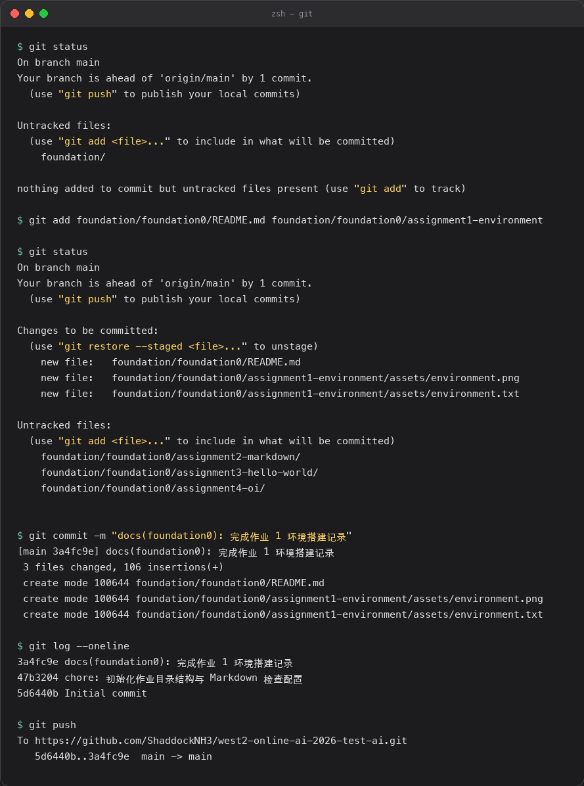

# 疯狂的一天：从空文件夹到第一次 push

> 记录配环境、写第一份 Markdown、第一次把代码推上 GitHub 的完整过程。
> 这一天的主题不是"学会了什么"，而是"被什么卡住过"。

## 引子

清早打开电脑的时候，桌面上的 `learn-ai` 还只是一个空文件夹。

到了晚上关灯的时候，同一个文件夹里躺着四个 `.py`、一份 Markdown、一个 `.venv` ，
以及一条指向 GitHub 的 `origin`。

中间隔着十个小时、三次想砸键盘、和一句反复出现的报错：`command not found`。

## 早上：把环境按下去

### 第一件事是选 Python 版本

我原本以为装个 Python 就是点下一步、下一步、完成。

结果第一节课就被告知：版本选错了，后面装的库有一半会报错。
考核文档写得很清楚，选 3.12.3 而不是最新的 3.13 或 3.14，
原因是主流 AI 框架对最新版本的支持还没跟上。

这句话我一开始不太信，直到在别人的博客里看到"小版本号变一下，代码全炸"的说法。

### 然后是虚拟环境

虚拟环境的概念第一次听起来很抽象。
直到我在同一个 Python 里装了两个互相冲突的库，才明白它的意义：
每个项目一个 `.venv`，就像每个项目一个独立的抽屉，谁也不会串味。

创建和激活只有三行命令：

```zsh
uv venv --python 3.12.3
source .venv/bin/activate
uv pip install requests
```

激活成功的标志是终端提示符前面多了一个 `(.venv)`。
我第一次没看到这个前缀，以为是命令没生效，来回折腾了二十分钟，
最后发现是新建了一个终端窗口——环境变量的作用域只在当前 shell 里。

## 中午：第一份 Markdown

Markdown 的学习成本极低，写起来像在写记事本。

标题用 `#`，强调用 `**`，代码用三个反引号包起来，
表格用竖线分隔，看起来乱，渲染出来却意外地整洁。

真正花时间的不是语法，是排版规范。
苹果文档规范要求中文与英文、中文与数字之间各留一个空格。
手动敲很容易漏，我后来的做法是先写完再统一过一遍工具，
而不是边写边数空格——后者会让写作变成校对。

## 下午：Git 的三条命令

Git 一开始给我的感觉是"命令太多"。
但真正跑通一次流程就会发现，日常只反复用这四条：

```zsh
git status          # 我现在在哪个状态
git add .           # 把改动放进暂存区
git commit -m "..." # 拍一张快照
git push            # 把快照送到远端
```

`git status` 是我最喜欢的命令，因为它永远在回答同一个问题：
"我现在到底在干什么"。不确定的时候先敲它，几乎不会错。

下面是当天在终端里提交作业时的真实操作记录：



截图里能看到 `git status` 输出的 `Untracked files`，
`git add` 之后同一批文件变成 `Changes to be committed`，
以及提交完成后 `git log --oneline` 里多出来的那一行。

### 提交信息怎么写

一开始我写的是 `update`、`fix`、`111`。

被建议之后改成了「类型 (范围): 描述」的写法，例如：

- `feat(foundation0): 完成作业 3 Hello World`
- `docs(foundation0): 补充环境搭建记录`
- `fix(oi): 修正闰年判定中 400 的整除条件`

好处是几个月后回来看 `git log`，不用点进 diff 就知道每次提交做了什么。

## 晚上：踩过的坑

一整天的坑大致可以归成这张表：

| 时间 | 现象 | 原因 | 解决办法 |
| --- | --- | --- | --- |
| 09:40 | `python: command not found` | 安装时没勾选加入 PATH | 用 `uv python install` 重装并固定版本 |
| 11:20 | 装库报 `Permission denied` | 装到了系统 Python 里 | 先激活 `.venv` 再装 |
| 14:05 | 代码块渲染成一整段 | 反引号数量不匹配 | 用三个反引号，并在开头标注语言 |
| 16:30 | `git push` 要求输入密码 | 用了 HTTPS 方式克隆 | 配置 token 或改用 SSH |
| 19:15 | 提交里混进了 `.venv` | 没有写 `.gitignore` | 先写 `.gitignore` 再 `git add` |

最后一条最值得记：**`.gitignore` 要在第一次 `git add` 之前写好。**
一旦虚拟环境被提交进去，后面再删就会留下一大坨历史记录，
仓库体积也跟着涨上去。

## 结尾

回头看，这一天学到的东西里，语法只占很小一部分。

更多的时间花在了三件更基础的事上：

1. 知道自己现在在哪个环境里（`which python`、`(.venv)` 前缀）；
2. 知道改动现在处于哪个状态（`git status`）；
3. 出错时先读报错，而不是先搜答案。

这三件事都不难，但它们决定了后面写代码时是顺手还是别扭。

参考链接：

- [Python 官方网站](https://www.python.org/downloads/)
- [Markdown 基本语法](https://markdown.com.cn/basic-syntax/)
- [Pro Git 中文版](https://git-scm.com/book/zh/v2)
- [洛谷题单](https://www.luogu.com.cn/)
